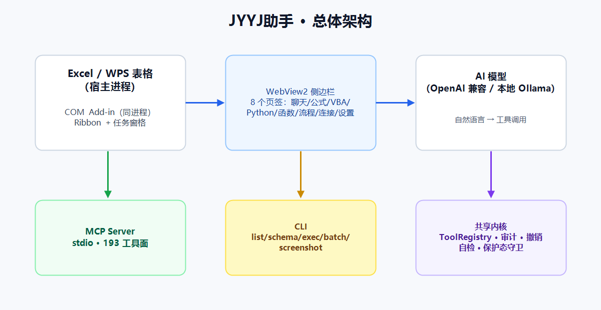
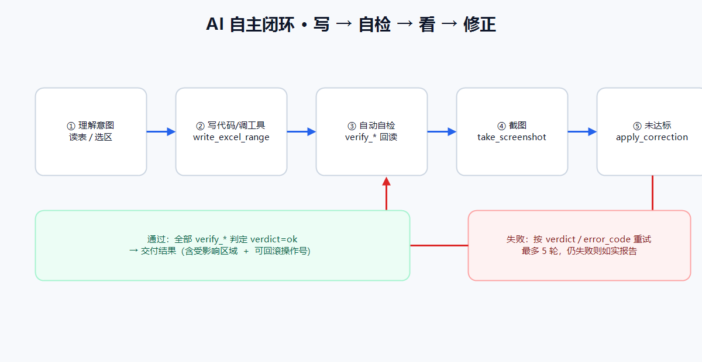
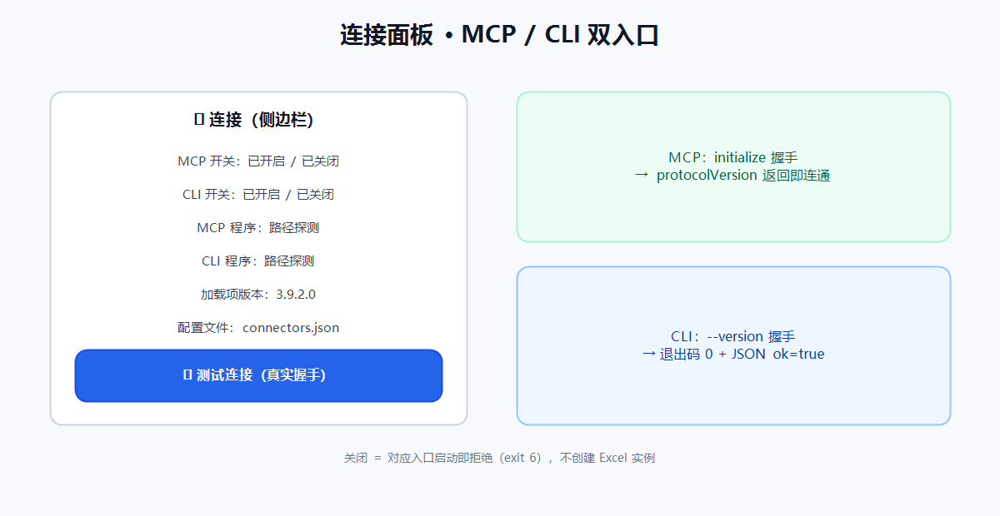

# JYYJ助手（v3.9.9.9）

> 内嵌 Excel / WPS 表格的 AI 办公助手：用中文说需求，AI 直接在**你打开的这张表**上清洗、统计、画图、做看板、跑公式与脚本。
> 每一次写入都有快照、可回滚、自动自检；不确定的结果会自己截图复核、自己改到对为止。



**30 秒了解它和"聊天式 AI"的区别**

| 普通 AI 对话 | JYYJ助手 |
|---|---|
| 给你一段代码，让你自己粘贴 | 直接写入你当前的表格，并回读核对 |
| 说"已帮你处理"，你无法验证 | `verify_*` 自检 + 截图复核，不达标不放行 |
| 改错了只能撤销一次 | 每个操作都有 operation_id，可逐个回滚 |
| 只能复制文本 | 176 个工具：透视/图表/看板/条件格式/迷你图/VBA/Python/流程编排 |
| 换个客户端就没了 | MCP + CLI 双入口，Claude Desktop / 脚本都能直连 |

---

## 目录

- [它是什么](#它是什么)
- [三张图看懂](#三张图看懂)
- [安装](#安装)
- [5 分钟上手](#5-分钟上手)
- [两种界面](#两种界面)
- [外部接口：MCP 与 CLI](#外部接口mcp-与-cli)
- [20 个使用实例](#20-个使用实例)
- [安全与可回滚](#安全与可回滚)
- [常见问题](#常见问题)
- [免责声明](#免责声明)
- [文档与版本](#文档与版本)

---

## 它是什么

**JYYJ助手 = Excel/WPS 加载项 + WebView2 侧边栏 + 可插拔 AI 模型。**

- **加载项（COM Add-in）**：与 Excel 同进程，读取当前工作簿、选区、公式与格式。
- **侧边栏（WebView2）**：聊天、公式、VBA、Python、函数库、流程、连接、设置 8 个页签。
- **工具内核（176 个）**：所有对表格的操作都是受控工具，而不是任意脚本。
- **两条外部通道**：MCP Server（给 AI 客户端）与 CLI（给脚本/流水线）。

三个硬约束贯穿全部功能：

1. **写后可回滚**：每次写入登记 operation_id 与快照。
2. **写后必自检**：结构/数据类写入自动推导 `verify_*` 回读核对。
3. **危险有边界**：整表删除等需确认；代码执行类工具始终保留确认门。

---

## 三张图看懂

### 1. 总体架构


- 加载项与 WebView2 同进程 → 侧边栏能直接看到"当前选区"。
- MCP / CLI 是**独立进程**，各自新建内存工作簿，不碰你正在编辑的文件。
- 三条通道共用同一套工具内核与审计。

### 2. AI 自主闭环



写 → 自检 → 截图 → 修正，最多 5 轮；仍不达标就如实报告差异，而不是"假装成功"。

### 3. MCP / CLI 连接面板



侧边栏「🔌 连接」页统一管理两个外部入口：开关、真实握手测试、客户端配置一键复制。

---

## 可靠性开关（M36）

| 开关 | 作用 | 默认 |
|---|---|---|
| `JYYJ_TOOL_PROFILE=core` | 只暴露 54 个高频工具（`tools/list` 从 197 项/238KB 降到 54 项/72KB，省约 70% 上下文） | `all` |
| 写操作去重 | 10 分钟内「同工具 + 同参数」的重复写被拦，返回 `DUPLICATE_WRITE_SUPPRESSED`；`args.allow_duplicate=true` 放行 | 开启 |
| 版本探测 | `ExcelAiMcpServer.exe --version` / `ExcelAiCli.exe --version` 输出 JSON 版本与当前工具面，不启动 Excel | — |
| 错误码目录 | 31 条错误码统一给出「含义 + 下一步动作」，MCP / CLI / 侧边栏同一口径（见 `docs/错误码目录.md`） | 开启 |

> 失败（缺参数、受保护、瞬态错误）**不会**被去重拦截，可原样重试；部分写入（`BATCH_WRITE_PARTIAL`）仍会防重。

## 安装

### 方式 A：安装版（推荐）

1. 到 [Releases](https://github.com/Asaceoo/ExeclAi/releases) 下载 `JYYJ-3.9.9.9-Setup-wps.exe`。
2. 双击安装（安装器会按本机 Excel/WPS 位数自动注册 32/64 位 COM 类）。
3. 完全退出 Excel（含后台进程）后重新打开。
4. 顶部出现 **JYYJ助手** 选项卡 → 点「打开面板」。

### 方式 B：便携 zip

下载 `JYYJ-3.9.9.9-wps-x64.zip` 或 `x86` 版，解压后运行目录内 `register-x64.ps1` / `register-x86.ps1`（无需管理员）。

### 方式 C：程序目录包（高级）

下载 `JYYJ-3.9.9.9-wps-portable-single-x64.zip`，解压后是**纯程序目录**（`ExcelAiAssistant.AddIn.dll` + 依赖 + WebView2 运行时，多个文件，不是单个 exe）。

> 说明：本产品是 COM 加载项，必须由宿主（WPS/Excel）加载 DLL，并依赖 WebView2 原生运行时，因此**不存在"单个 exe 双击即用"的形态**——可执行入口由宿主提供。这个包给外壳程序（如 `jyyj-mcp`）和需要自定义安装位置的高级用户使用；普通用户请走方式 A 安装器。

### 方式 D：不装加载项也能用（MCP）

```bash
npx jyyj-mcp config   # 打印 Claude Desktop 的 mcpServers 配置
npx jyyj-mcp run      # 直接 stdio 启动
```

### 面板看不到？

多为 Excel 把加载项置为 `LoadBehavior=2`（已禁用）。执行：

```powershell
# 仅诊断（不改注册表）
powershell -NoProfile -ExecutionPolicy Bypass -File tools\installer\diagnose.ps1

# 自动修复（改 HKCU 的 LoadBehavior/CLSID，无需管理员）
powershell -NoProfile -ExecutionPolicy Bypass -File tools\installer\repair-addin.ps1
```

修复后**完全退出 Excel** 再打开。

---

## 5 分钟上手

1. **配模型**：侧边栏 → 设置 →「模型方案」填 Base URL / API Key / 模型名 → 点「测试」。
   - 支持任意 OpenAI 兼容端点，也可以填本地 Ollama（如 `http://localhost:11434/v1`）。
   - Key 在本机用 DPAPI 加密存储。
2. **选数据**：在表里选中要处理的数据区域（不选则按当前已用区域推断）。
3. **说需求**：直接用中文描述，例如"按月份汇总销售额，画柱状图放在右侧"。
4. **看结果**：回复会列出用到的工具、受影响区域、自检结论；每条写入都能单独回滚。

---

## 两种界面

### 功能区（Ribbon）

`JYYJ助手` 选项卡下按场景分组：面板、视图（聚光灯/指针）、数据处理（清洗/去重/排序/转置/筛选/透视/超级看板）、文本处理、更多（宏收纳箱/函数库/SQL）、**连接（MCP/CLI 面板）**。

### 侧边栏（8 个页签）

| 页签 | 用途 |
|---|---|
| 💬 聊天 | 自然语言驱动，最常用 |
| ∑ 公式 | 生成、解释、诊断、批量改写公式 |
| 📝 VBA | 模板库、生成、校验、执行（确认门） |
| 🐍 Python | 沙箱执行、写回表格、包管理 |
| f(x) 函数 | 内置函数速查与用法 |
| ⚙ 流程 | 内置流程模板 + 自定义编排 |
| 🔌 连接 | MCP/CLI 开关、连通性自检、客户端配置 |
| 👤 设置 | 模型、记忆、受控执行、技能、日志、自检、版本 |

---

## 外部接口：MCP 与 CLI

### MCP（Claude Desktop 等）

```json
{
  "mcpServers": {
    "jyyj-excel": {
      "command": "C:\\Users\\<你>\\AppData\\Local\\XaiAssistant\\app\\x64\\ExcelAiMcpServer.exe"
    }
  }
}
```

- 默认**只读**；需要写入时在 `args` 加 `--allow-write`。
- 自主模式默认开启（结构/数据类危险操作直接执行）；**代码执行类**（VBA/Python/CLI/EXE/包安装）与**路径敏感类**（打开外部工作簿/替换外部链接）仍走确认门。
- 需要人工确认门：启动参数加 `--require-confirmation`，或设 `JYYJ_AI_AUTONOMOUS=0`。

### CLI

```powershell
ExcelAiCli list                                    # 工具清单（会启动一次隐藏 Excel）
ExcelAiCli schema write_excel_range                # 参数 schema
ExcelAiCli exec get_current_excel_context          # 执行只读工具
ExcelAiCli exec write_excel_range --sheet Sheet1 --address A1:B2 --json '[["姓名","分数"],["张三",95]]' --allow-write
ExcelAiCli batch --file ops.json --allow-write     # 同进程批量执行
ExcelAiCli screenshot --target range --address A1:F20 --base64 --allow-write
ExcelAiCli version                                 # 读版本（不启动 Excel）
```

退出码：`0` 成功 · `1` 工具失败 · `2` 用法错误 · `3` 启动失败 · `4` 危险操作待确认 · `5` COM 缺失 · `6` 外部接口面已在「连接」面板关闭。

---

### 一键接入本机 AI 客户端

用一条命令把 JYYJ 的 MCP server 登记进已安装的 AI 客户端（WorkBuddy / DSH / Codex / Claude Code / Trae / Cursor / Windsurf），不用手改 JSON：

```bash
ExcelAiCli clients                          # 看装了哪些、配了没
ExcelAiCli clients --connect workbuddy      # 预览要写的内容（不落盘）
ExcelAiCli clients --connect all --apply    # 写入全部已安装客户端（原配置备份为 *.jyyj-bak）
ExcelAiCli clients --connect dsh --apply --allow-write   # 让接进来的 AI 能写表格
ExcelAiCli clients --test                   # 用各客户端配置里的真实命令跑一次 MCP 握手
```

AI 侧也能自己干这件事（MCP 三个工具）：`detect_ai_clients` → `connect_ai_client`（默认只预览，`apply=true` 才写）→ `test_ai_client_connection`（真实握手，返回 `reachable` 与耗时）。写入只新增/更新 `jyyj-excel` 一项，不动别人的条目。
### 闭环三件套：AI 自己规划、执行、自检、纠错

| 工具 | 级别 | 用途 |
|---|---|---|
| `run_self_check` | 只读 | 传「主工具名 + 实参」→ 自动推导并执行 `verify_*` 计划 → 返回 `passed/failed` 与 `verdict`。不写表，可反复调用 |
| `apply_correction` | 写入 | 修正阶梯 ≤5 轮，每轮自带 verify；**以 `verified` 字段为准**，`verified=false` 不算通过 |
| `render_range_image` | 只读 | 只读渲染成图（不碰剪贴板、不插图表），只读模式也能看图 |
| `take_screenshot` | 写入 | 像素级截图（需 `--allow-write`），会占用剪贴板 |

推荐节奏：主工具 → `run_self_check` → 不通过用 `apply_correction`（≤5 轮）→ 仍不通过就如实报告差异，不要声称已修好。
**可直接复制的自检链**（`args` 必须与主工具实参**完全一致**，漏传会得到 `NO_VERIFY_PLAN`）：

```powershell
# 1) 清洗写回
ExcelAiCli exec clean_excel_data --json '{"sheet":"Sheet1","address":"A1:A200","operations":[{"tool":"fix_dates","column":1,"date_format":"yyyy-mm-dd"}]}' --allow-write
# 2) 自检（只读，无需 --allow-write）
ExcelAiCli exec run_self_check --json '{"tool":"clean_excel_data","args":{"sheet":"Sheet1","address":"A1:A200","operations":[{"tool":"fix_dates","column":1,"date_format":"yyyy-mm-dd"}]}}'
# 3) 只有 overall_ok=true 且各 checks[].verdict=ok 才算通过；要看外观再渲染（只读）
ExcelAiCli exec render_range_image --json '{"sheet":"Sheet1","address":"A1:A20"}'
```

> ⚠️ `run_self_check` 返回 `NO_VERIFY_PLAN` / `INVALID_ARGS` 只表示「这组工具+实参推导不出自检计划」，**不代表写入失败**：此时禁止重写同一区域、禁止用 `undo_excel_operation` 回滚，改用显式 `verify_*`（如 `verify_data_clean`）复核。只有 `overall_ok=false` 且 `checks[].issues` 明确指出数据不符时，才回滚重试。
需要"看见"结果时先 `render_range_image`（只读、近似还原），确需像素级外观再用 `take_screenshot`。

### 两条看图通路，别混用

| 通路 | 级别 | 前置 | 何时用 |
|---|---|---|---|
| `render_range_image` | 只读 | 无 | 确认结构/表头/空列/数字格式；近似还原，不还原合并单元格与条件格式 |
| `take_screenshot` | 写入 | `--allow-write` | 需要像素级外观（合并、边框、图表遮挡） |

截图只判"好不好看"，**取值正确性一律以 `verify_*` 的 `verdict` 为准**。

## 20 个使用实例

> 全部可直接照抄：在侧边栏把"需求"发给 AI；或按「工具 + 参数」用 CLI 执行。

**数据读写与清洗**

1. **文本型数字转数值**：「B 列是从系统导出的文本型数字，转成真正的数值」→ 先用 `build_formula` 生成 `=VALUE(B2)` 再 `write_excel_range` 回写（`clean_excel_data` 只做去空行/修日期/填空值，不做类型转换）
2. **去空行修日期**：「去掉整行都为空的行，把 A 列统一成 2024-01-01 格式」→ `clean_excel_data`
3. **批量写入**：「把下面 10 行数据写到 A2 开始的区域」→ `write_excel_range`
3b. **写完自检**：「把数据写到 A2，然后自己核对一遍」→ `write_excel_range` → `run_self_check`；不通过用 `apply_correction`（以 verified 为准），仍不通过就报差异
4. **追加记录**：「在这批记录后面追加 3 行新数据」→ `append_excel_rows`
5. **条件筛选导出**：「把销售额大于 1 万的行复制到 Sheet2」→ `filter_excel_data`

**分析汇总**

6. **按月透视**：「按 B 列月份汇总 F 列销售额，结果放 H 列」→ `create_excel_pivot_summary`
7. **分组计数**：「统计每个区域出现多少条记录」→ `count_group`
8. **去重统计**：「对客户名单去重，告诉我唯一客户数」→ `remove_duplicates`
9. **异常值筛查**：「找出数值列里超过 3σ 的异常行并标记」→ `analyze_column_profile` + `flag_cells`
10. **相关性分析**：「算销售额和广告投入的相关系数」→ `analyze_column_correlation`

**图表与看板**

11. **基础图表**：「按月份画销售额柱状图，放在数据右侧」→ `create_excel_chart`
11b. **画完看图确认**：「画完自己看一眼有没有压住数据」→ `create_excel_chart` → `run_self_check` → `render_range_image`（只读）；确需像素级再用 `take_screenshot --allow-write`
12. **双轴组合图**：「销售额画柱、销量画折线，做双轴组合图」→ `create_combo_chart`
13. **KPI 速览**：「给这份数据做个 4 张卡片的 KPI 看板」→ `create_dashboard_kpi_brief`
14. **交互看板**：「做一个销售概览看板，支持地区下拉联动」→ `render_dashboard`
15. **超级看板三视图**：「生成数据底座 + KPI 卡 + 四宫格 + 指标切换」→ `render_super_dashboard`

**公式与脚本**

16. **公式解释**：「解释 F2 这个嵌套公式的含义」→ `explain_formula`
17. **批量改写**：「把所有 VLOOKUP 改成 XLOOKUP 写法」→ `rewrite_formulas`
18. **VBA 生成执行**：「写个 VBA 把所有工作表按名称排序，执行前给我看代码」→ `run_vba_snippet`（确认门）
19. **Python 深度分析**：「用 Python 对这列跑聚类，把分群结果写回新列」→ `run_python_excel`（确认门）

**自动化与集成**

20. **外部 AI 接入**：Claude Desktop 接 MCP 后说「把桌面 data.xlsx 的 Sheet1 汇总成月度报告」→ MCP 直调 197 工具面；或 `ExcelAiCli exec create_excel_pivot_summary --json "{...}" --allow-write`。

更多工具级用法见[用户手册](docs/JYYJ助手用户手册-3.9.9.9.md)第十一章「功能全景：全部工具速查」。

---

## 安全与可回滚

| 机制 | 说明 |
|---|---|
| 快照与回滚 | 每次写入前存快照；`undo_excel_operation` 按 operation_id 回滚 |
| 自动自检 | 85+ 主工具映射到 `verify_*`，`verdict` 不通过即不交付 |
| 保护态守卫 | 目标表被保护时前置拦截并给原因，不产生裸 COM 异常 |
| 危险分级 | ReadOnly / NormalWrite / StructuralChange / Dangerous 四级 |
| 确认门 | 整表删除等破坏性操作需显式确认；代码执行类始终保留 |
| 防公式注入 | `value_mode=value` 时对 `= + - @` 开头文本加前导 `'` 转文本 |
| 路径安全 | 导出/备份路径拒 `..`、UNC、网络盘与重解析点 |
| 审计 | 写入登记到 SQLite，可导出运行日志 |

---

## 常见问题

**Q：面板/选项卡不显示？**
A：先跑 `tools\installer\diagnose.ps1`，再跑 `tools\installer\repair-addin.ps1`，然后完全退出 Excel 重开。

**Q：AI 说改好了，但表里没变化？**
A：看回复里的 `verdict` / `error_code`；失败时通常会给下一步。也可以说"帮我截图看看 A1:F20 现在是什么样"。

**Q：能处理多大数据量？**
A：单次写入有格数上限（防整列地址 OOM），大表建议分批或用透视/看板；超限会明确报错而非静默截断。

**Q：会不会动我正在编辑的文件？**
A：MCP/CLI 只操作各自新建的内存工作簿；加载项只操作你当前打开的工作簿，且所有写入可回滚。

**Q：联网搜索？**
A：设置 → 联网搜索开关，默认关闭；工具为 `web_search`。

---

## 免责声明

> **请在使用前完整阅读本节。**

1. **按"现状"提供**：本软件及文档按现状提供，不附带任何明示或默示担保，包括但不限于适销性、特定用途适用性与不侵权担保。
2. **AI 输出不保证正确**：AI 生成的内容、公式、代码、图表与结论可能存在错误或偏差。**使用者必须自行核对结果**，尤其在财务、税务、审计、医疗、法律等高风险场景。因使用或依赖本软件输出导致的任何直接或间接损失，作者与贡献者不承担责任。
3. **数据与合规责任在用户**：请在处理敏感/个人信息前确认符合你所在组织与地区的合规要求（如个人信息保护法、GDPR）。软件默认不向第三方发送遥测；但配置的 AI 端点会接收你发送的提示与必要的表格片段，请自行评估该端点的可信度。
4. **代码执行风险**：VBA / Python / 命令行 / EXE 类工具具备本机执行能力，默认保留人工确认门。请勿在不可信环境中放开确认门或使用来源不明的脚本。
5. **备份建议**：重要文件请先自行备份。软件提供自动快照与回滚，但**不构成数据安全保证**。
6. **第三方组件**：WebView2、SQLite、Newtonsoft.Json 等遵循各自许可；详见安装目录内说明与各项目主页。
7. **无官方支持承诺**：本项目为开源软件，不承诺响应时效或问题必解；Issue 与 PR 欢迎但不保证合并。

---

## 文档与版本

| 文档 | 链接 |
|---|---|
| 用户手册 | [docs/JYYJ助手用户手册-3.9.9.9.md](docs/JYYJ助手用户手册-3.9.9.9.md) |
| 技术手册 | [docs/JYYJ助手技术手册-3.9.9.9.md](docs/JYYJ助手技术手册-3.9.9.9.md) |
| 踩坑与规避 | [docs/踩坑记录与规避手册.md](docs/踩坑记录与规避手册.md) |
| 版本史 | [docs/版本史.md](docs/版本史.md) |

**版本规则**：版本号单一来源是根目录 `Directory.Build.props`。`python tools/release/release.py bump --ver x.y.z.w` 会同步 README、四份手册文件名与版本戳、npm 外壳；`pack` **默认自动末位递增并打包**（可用 `--no-bump` 关闭）。

**工具口径**：代码注册 **176** 个；WPS 全量巡检 = 176 + 桥接 4 + 看板浮动；MCP `tools/list` = 176 + 桥接 4 + 用户沉淀 `ct_` 17 = **197**。