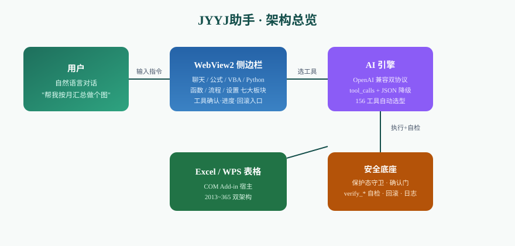
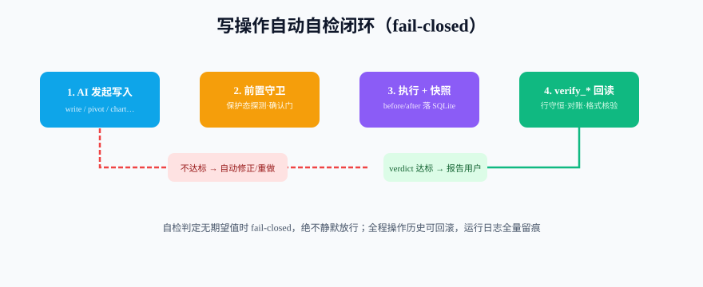

# JYYJ助手

**内嵌 Excel 的 AI 办公助手** —— 用自然语言操作表格：写入、清洗、分析、图表、看板、VBA、流程编排，AI 经 **167 个内置工具**直接完成，所有写操作**自动自检、可回滚、全量留痕**。

> 软件地址：https://github.com/Asaceoo/ExeclAi · 当前版本（v3.9.1.1） · Windows / .NET Framework 4.8 / Excel 2013~365 与 WPS 表格（x64 + x86）

---

## 这是什么

在 Excel/WPS 右侧打开一个 AI 侧边栏，像对话一样下指令：

- "把这列文本型数字转成数值，去掉空行"
- "按月汇总销售额，做成柱状图 + 环形占比"
- "对照目标列算达成率，生成一份经营分析报告"
- "写个 VBA，把所有sheet按名称排序"

AI 从 **167 个工具**里自动选型执行——每个写动作都带前置守卫、执行快照、结果自检与回滚。

### 真实界面（v3.9.1.1 实测截图）


> 左：一次「月度销售汇总 + 柱状图」任务的完整执行流——思考 → 5 步工具调用（每步带影响范围与 ✓ 自检通过标记）→ 结论先行 + 四段式报告（图表分析/数据分析/计算依据/图表自检）。


> 右：流程编排面板——39 个内置模板，聊天里输入 `@workflow:名称` 直接触发，也可把成功会话步骤一键另存为流程。



## 核心特性

- **167 工具全家桶**：读写、清洗、透视、图表（柱/条/折/饼/环形/瀑布/树状/漏斗/甘特…）、KPI 看板与超级看板、超链接、图片、冻结窗格、公式解释与改写、VBA、Python 分析、流程编排、联网搜索。
- **写操作 fail-closed 自检闭环**：20 个 verify_* 自检族在工具执行后回读核验（排序行守恒、透视数量对账、格式核验…），不达标自动修正，绝不静默报成功。
- **三层安全防线**：保护态守卫（工作表加密前置拦截）→ 确认门（删除等危险操作需人工确认）→ 操作历史回滚（SQLite 快照，冲突修改阻止回滚）。
- **双宿主双架构**：Excel 2013/2016/2019/2021/365 与 WPS 表格（无 VBA 环境自动降级），x64/x86 安装包齐备。
- **可观测**：一键自检（AI 研判）、全功能巡检（22 项子系统体检）、运行日志全量留痕。



## 七大面板


## 为什么选 JYYJ助手

| 维度 | **JYYJ助手** | Microsoft 365 Copilot | SheetTalk 类侧边栏 | OfficeCLI / xlsx-for-ai |
|---|---|---|---|---|
| 价格 | 一次性，无订阅 | 按月订阅（M365 另计） | 多为免费/开源 | 免费开源 |
| 离线/私有模型 | ✅ OpenAI 兼容任意端点（含本地 Ollama） | ❌ 仅微软云 | 部分 | 取决于客户端 |
| 操作对象 | ✅ **当前打开的真实工作簿**（Excel+WPS 双宿主） | 当前工作簿 | 当前工作簿 | ❌ 只处理离线文件 |
| 工具广度 | **167 工具**（读写/透视/13 类图表/看板/VBA/Python/流程） | 以公式与洞察为主 | 公式+图表为主 | L2 元素层为主 |
| 写后自检 | ✅ 20 个 verify_* 回读核验，不达标不放行 | ❌ 无 | ❌ 无 | ❌ 无 |
| 可回滚 | ✅ SQLite 操作快照 + undo，冲突阻止回滚 | 依赖 Excel 自带撤销 | ❌ 通常不可 | 文件级重跑 |
| 危险操作门 | ✅ 一次性确认码（码只落文件，AI 无法自答） | 部分 | ❌ | ❌ |
| 保护态感知 | ✅ 加密/只读表前置拦截并给原因 | 部分 | ❌ | ❌ |
| 草稿人审 | ✅ 隐藏副本改稿 → diff 预览 → 采纳/放弃 | ❌ | ❌ | ✅（worktree 类） |
| AI 客户端接入 | ✅ MCP（npx 一键）+ CLI，Claude Desktop / DSH / workbuddy 直连 | 锁在 M365 | ❌ | ✅ |
| 真机质量门禁 | ✅ 1321 单测 + 119 真机断言 + WPS 全功能基线巡检 | — | — | — |

> 一句话：**别人让 AI 会说 Excel，JYYJ助手让 AI 敢动你的表**——每个写动作都有守卫、快照、自检、回滚四道保险。

| 板块 | 能做什么 |
|------|---------|
| 💬 聊天 | 对话改表、数据分析报告（14 职能视角）、深度分析、数据专家团、联网搜索 |
| ∑ 公式 | 公式解释、构造、批量改写、验证闭环 |
| ⌨ VBA | 生成/校验/执行（高危确认门）、自动沉淀复用 |
| 🐍 Python | 受控 Python 执行、pandas 分析、失败自动回滚 |
| 🧮 函数库 | 内置 UDF 面板、SQL 查询 |
| ⚙ 流程 | 39 个内置编排模板 + 自定义流程 |
| 🛡 设置 | 模型配置（OpenAI 兼容，DPAPI 加密）、自检、日志、回滚 |

## 快速开始

1. **安装**：从 [Releases v3.9.1.1](https://github.com/Asaceoo/ExeclAi/releases/tag/v3.9.1.1) 下载 `JYYJ-3.9.1.1-Setup-wps.exe`（安装版）或 `JYYJ-3.9.1.1-wps-x64.zip`（便携版），自动匹配 Excel/WPS 位数。
2. **配置模型**：打开侧边栏 → 设置 → 填 OpenAI 兼容的 Base URL / API Key / 模型名（本机 DPAPI 加密存储）。
3. **开聊**：选中数据区域，直接说需求。

### 让外部 AI 智能体接入（Claude Desktop / DSH / workbuddy）

```bash
npx jyyj-mcp config          # 打印 MCP 配置片段（本机无 exe 会自动拉便携版）
npx jyyj-mcp run             # 直接 stdio 启动（客户端 command 也可指这一条）
```

- 接入后可用全部 167 工具 + 4 个记忆桥（`buddy_read/search/append_memory`），写操作同样审计可回滚；
- 缺省只读模式，加 `--allow-write` 开写；Dangerous 工具走一次性确认码（AI 无法自答）。

构建开发版：

```powershell
dotnet build ExcelAiAssistant.sln -c Release      # 警告即错误
dotnet test ExcelAiAssistant.sln -c Release       # 1321 用例
python tools/release/release.py bump --ver x.y.z.w   # 升版（单一来源）
python tools/release/gate.py --pack                  # 门禁直通发版
```

## 用法与使用说明

### 三种使用方式

| 方式 | 适合谁 | 入口 |
|------|--------|------|
| **侧边栏对话**（推荐） | 所有人 | Excel/WPS 里点「JYYJ助手 → 打开面板」，直接说需求 |
| **MCP server** | Claude Desktop / 支持 MCP 的 AI 客户端 | `tools/McpServer/ExcelAiMcpServer.exe`（stdio，默认只读，`--allow-write` 开放写入） |
| **CLI 命令行** | 脚本 / 自动化流水线 | `tools/CliServer/ExcelAiCli.exe list | schema | exec`（默认只读，`--allow-write` + `--confirmed`） |

### 侧边栏使用说明

1. **选中再问**：先选中数据区域（或让 AI 自动识别整表），再描述需求。
2. **看确认再放行**：删除工作表、执行 VBA/Python 等危险操作会弹确认框，看清影响范围再点「允许执行」。
3. **写完可回滚**：每次写入自动留快照，设置中心「回滚 AI 的修改」可撤销最近操作。
4. **一键宏**：功能区「数据分析报告」「洞察分析」「深度分析」「数据专家团」四个一键宏，一键产出完整报告。
5. **自检兜底**：所有写操作执行后自动回读核验（行守恒/数字对账/格式核验），不达标自动修正。

### MCP server 接入（Claude Desktop）

```json
{
  "mcpServers": {
    "jyyj-excel": {
      "command": "D:\\execl1.0-wps\\tools\\McpServer\\bin\\Release\\net48\\ExcelAiMcpServer.exe",
      "args": ["--allow-write"]
    }
  }
}
```

### CLI 使用说明

```powershell
ExcelAiCli list                                          # 列出全部工具（名称/风险级/描述）
ExcelAiCli schema rename_excel_worksheet                 # 查看参数 schema
ExcelAiCli exec get_current_excel_context                # 执行只读工具
ExcelAiCli exec preview_excel_range --address A1:C10     # 带参数执行
```

退出码：`0` 成功 · `1` 工具失败 · `2` 用法错误 · `3` 启动失败 · `4` 危险操作待确认 · `5` COM 缺失。
写操作追加 `--allow-write`；删除类追加 `--confirmed` 确认。

## 20 个使用实例

以下实例全部可直接照抄（侧边栏对话直接说；CLI 按「工具 + 参数」对照执行）。

**数据读写与清洗**

1. **转换文本型数字**：「B 列是从系统导出的文本型数字，转成真正的数值」→ `clean_excel_data`
2. **去空行修日期**：「去掉整行都为空的行，把 A 列统一成 2024-01-01 格式」→ `clean_excel_data`
3. **批量写入**：「把下面 10 行数据写到 A2 开始的区域」→ `write_excel_range`
4. **追加记录**：「在这批记录后面追加 3 行新数据」→ `append_excel_rows`
5. **条件筛选导出**：「把销售额大于 1 万的行复制到 Sheet2」→ `filter_excel_data`

**分析汇总**

6. **按月透视汇总**：「按 B 列月份汇总 F 列销售额，结果放 H 列」→ `create_excel_pivot_summary`
7. **分组计数统计**：「统计每个区域出现多少条记录」→ `count_group`
8. **去重统计**：「对客户名单去重，告诉我唯一客户数」→ `remove_duplicates`
9. **环比同比**：「找到同期销售额列，算每月环比增幅」→ 报告宏（基线对比先行）
10. **达成率分析**：「对照销售额目标列，算每个产品的达成率并排序」→ 报告宏

**图表与看板**

11. **基础图表**：「按月份画销售额柱状图，放在数据右边」→ `create_excel_chart`
12. **双轴组合图**：「销售额画柱形、销量画折线，做双轴组合图」→ `create_combo_chart`
13. **KPI 看板**：「给这份数据做个 KPI 速览看板，要 4 张卡片」→ `create_dashboard_kpi_brief`
14. **交互看板**：「渲染一个销售概览看板，支持地区下拉联动」→ `render_dashboard`
15. **图表选型建议**：「这份数据适合画什么图？」→ `suggest_chart_mapping`

**公式与 VBA**

16. **公式解释**：「解释一下 F2 这个嵌套公式的含义」→ `explain_formula`
17. **批量改写公式**：「把所有 VLOOKUP 改成 XLOOKUP 写法」→ `rewrite_formulas`
18. **VBA 生成执行**：「写个 VBA，把所有工作表按名称排序，执行前给我看代码」→ `run_vba_snippet`（确认门）

**自动化与集成**

19. **Python 深度分析**：「用 Python 对这份数据跑聚类，把分群结果写回新列」→ `run_python_excel`（确认门）
20. **MCP/CLI 集成**：Claude Desktop 接入后「帮我把桌面 data.xlsx 的 Sheet1 汇总成月度报告」→ MCP 156 工具直调；或 CLI `ExcelAiCli exec create_excel_pivot_summary --json "{...}" --allow-write`

> 更多工具级用法见 [用户手册](docs/JYYJ助手用户手册-3.9.1.1.md) 第十一章「功能全景：全部工具速查」。

---

## 文档

- **用户手册**：[docs/JYYJ助手用户手册-3.9.1.1.md](docs/JYYJ助手用户手册-3.9.1.1.md)（同名 HTML/PDF）
- **技术手册**：[docs/JYYJ助手技术手册-3.9.1.1.md](docs/JYYJ助手技术手册-3.9.1.1.md)
- **踩坑手册**：[docs/踩坑记录与规避手册.md](docs/踩坑记录与规避手册.md)（120+ 真实血泪条目）
- **AI 交接文档**：[docs/AI交接文档.md](docs/AI交接文档.md)（AI 接手开发先读）

## 质量门禁

| 关卡 | 标准 |
|------|------|
| 单测 | 1309 用例全过（xUnit，警告即错误） |
| 真机 harness | 独立 Excel 实例 22 用例组 119 断言 |
| WPS 兼容 | full 基线 131 组结果分布校验 |
| 发版 | gate.py 一键：构建→单测→真机→WPS full→基线→泄漏断言→打包 |

## 免责声明

1. **本软件按"现状"提供**，不附带任何明示或默示的担保（包括但不限于适销性、特定用途适用性与不侵权的默示担保）。使用本软件所产生的任何直接或间接损失，由使用者自行承担。
2. **AI 生成内容需人工复核**：本软件执行的写入、清洗、分析与报告由 AI 模型驱动，输出前请自行核对关键数字与业务口径；软件内建的自动自检（verify_*）是工程兜底手段，不构成对结果正确性的保证。
3. **危险操作请确认后再放行**：删除工作表、删除看板、VBA/Python 执行等高危操作有确认门，请在确认弹窗中看清影响范围再放行；确认即视为授权执行。
4. **数据安全自担**：API Key 等凭据使用本机 DPAPI 加密存储，但请勿将工作簿敏感数据发送给不信任的模型服务方；联网搜索功能仅发送搜索关键词，不外发工作簿数据。
5. **第三方服务边界**：本软件依赖用户自行配置的 OpenAI 兼容模型服务，第三方服务的可用性、准确性与合规性由相应服务方负责。
6. 本软件与 Microsoft Excel、Kingsoft WPS 官方无隶属关系；Excel 与 WPS 为各自所有者的商标。

## 许可证

见 [LICENSE](LICENSE)。
