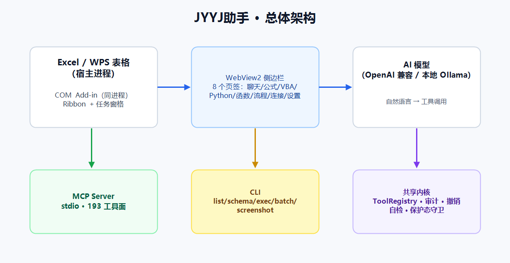
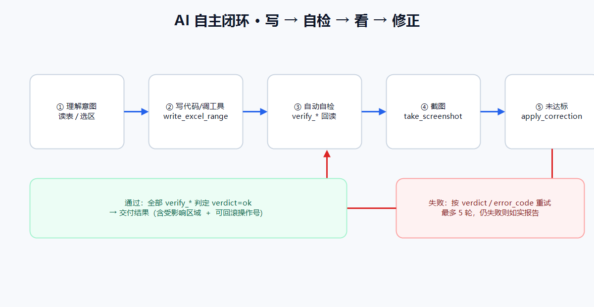

# JYYJ助手 技术手册

**版本：3.9.9.9**　|　面向：二次开发、排障、部署与审计

---

## 免责声明

> **请在使用前完整阅读本节。**

1. **按"现状"提供**：本软件、源码及本文档按现状提供，不附带任何明示或默示担保，包括但不限于适销性、特定用途适用性与不侵权担保。
2. **AI 输出不保证正确**：AI 生成的公式、代码、图表与结论可能存在错误或偏差；使用者必须自行核对，作者与贡献者不对因此产生的直接或间接损失承担责任。
3. **数据与合规责任在用户**：处理敏感/个人信息前请确认符合你所在组织与地区的合规要求；配置的 AI 端点会接收提示与必要的表格片段。
4. **代码执行风险**：VBA / Python / 命令行 / EXE 工具具备本机执行能力，默认保留确认门；请勿在不可信环境放开。
5. **备份建议**：重要数据请先备份；自动快照与回滚**不构成数据安全保证**。
6. **无官方支持承诺**：本项目为开源软件，不承诺响应时效或问题必解。

---

## 目录

1. [总体架构](#1-总体架构)
2. [解决方案结构](#2-解决方案结构)
3. [加载项与 COM 注册](#3-加载项与-com-注册)
4. [工具系统](#4-工具系统)
5. [自动自检体系](#5-自动自检体系)
6. [保护态守卫与安全边界](#6-保护态守卫与安全边界)
7. [审计、快照与回滚](#7-审计快照与回滚)
8. [MCP Server](#8-mcp-server)
9. [CLI](#9-cli)
10. [构建、升版与打包](#10-构建升版与打包)
11. [测试体系](#11-测试体系)
12. [性能与已知限制](#12-性能与已知限制)
13. [附录：错误码](#13-附录错误码)

---

## 1. 总体架构



| 层 | 进程 | 职责 |
|---|---|---|
| 宿主 | EXCEL.EXE / et.exe | 工作簿、选区、公式、格式 |
| 加载项 | 同宿主进程 | Ribbon、任务窗格、COM 桥、工具注册 |
| 界面 | WebView2（同进程） | 8 页签 UI，经 `hostObjects.excelAiBridge` 调宿主 |
| AI | 外部 HTTP（OpenAI 兼容） | 自然语言 → 工具调用 |
| MCP | 独立进程 | stdio JSON-RPC，供 AI 客户端直连 |
| CLI | 独立进程 | 命令行直调工具面 |

**关键设计取舍**

- 加载项与 WebView2 **同进程**：侧边栏可直接读取 `Selection`，无需跨进程序列化。
- MCP/CLI **独立进程**：各自 `Workbooks.Add()` 新建内存工作簿，**不碰用户文件**；退出时按 PID 回收（Job Object `KILL_ON_JOB_CLOSE` 兜底）。
- 三条通道共用同一 `ToolRegistry` 与审计，避免行为漂移。

---

## 2. 解决方案结构

```
ExcelAiAssistant.sln
├─ src/ExcelAiAssistant.Core          # 模型、配置、安全、审计、Agent、工作流
│   ├─ Agent/                         # AgentRunner、AutoVerifyPolicy、工具桥
│   ├─ Configuration/                 # 设置存储（agent/connectors）
│   ├─ Operations/                    # 操作记录与快照
│   └─ Security/                      # PathGuard 等
├─ src/ExcelAiAssistant.Excel         # 工具服务与注册（176 个工具面）
├─ src/ExcelAiAssistant.Addin         # Ribbon、WebView2 宿主、SidebarBridge
├─ src/ExcelAiAssistant.Tests         # xUnit 单测（1383）
├─ tools/McpServer                    # MCP stdio 服务
├─ tools/CliServer                    # CLI
├─ tools/RealMachineVerify            # 真机 harness（34 组 172 断言）
├─ tools/installer                    # iss + 注册/诊断/自愈脚本
└─ tools/release                      # release.py / gate.py / 基线校验
```

**依赖方向**：`Addin → Excel → Core`，`McpServer/CliServer → Excel → Core`；Core 不反向依赖。

---

## 3. 加载项与 COM 注册

### 3.1 注册模型

| ProgID | CLSID | 托管类型 |
|---|---|---|
| `ExcelAiAssistant.AddIn` | `{8F7A6D91-...-E001}` | `ExcelAiAssistant.Addin.ExcelAiAddIn` |
| `ExcelAiAssistant.TaskPaneHost` | `{...-E002}` | `...ExcelAiTaskPaneHost` |
| `ExcelAiAssistant.DeepSeekPaneHost` | `{...-E003}` | `...DeepSeekTaskPaneHost` |

每个 CLSID 需写入：

```
HKCU\Software\Classes\CLSID\{GUID}\
  InprocServer32            (默认)=mscoree.dll, ThreadingModel=Both, Class, Assembly, CodeBase, RuntimeVersion
  InprocServer32\<ver>      Class, Assembly, CodeBase, RuntimeVersion
  Implemented Categories\{62C8FE65-4EBB-45E7-B440-6E39B2CDBF29}
HKCU\Software\Classes\<ProgID>\CLSID (默认)={GUID}
HKCU\Software\Microsoft\Office\Excel\Addins\ExcelAiAssistant.AddIn  LoadBehavior=3
```

**双架构**：`RegistryView.Registry64 → app\x64`，`RegistryView.Registry32 → app\x86`，32/64 位 Excel/WPS 各读各的视图。

### 3.2 三个必须注意的坑

1. **版本子键的 `Class` 必须是本 ProgID 的真实类型**。若三个 CLSID 都写成 `ExcelAiAddIn`，Ribbon 能加载但 `CreateCTP` 报 `0x80004005 无法创建指定的 ActiveX 控件`——面板打不开。
2. **部署新版本要同步 `Assembly` 版本值**。`mscoree` 按注册的 `Assembly`（含版本）找文件，DLL 版本与注册值不一致会加载失败。
3. **`LoadBehavior=2` 表示被禁用**。此时 Ribbon XML 根本不会被读取，表现为"选项卡整块消失"。修复脚本会改回 3 并写 `DoNotDisableAddinList`。

### 3.3 自愈脚本

`tools/installer/repair-addin.ps1`：
- 默认只接受 `%LOCALAPPDATA%\XaiAssistant\app`；非标准目录需 `-Force`；
- 拒绝 UNC；缺架构时告警；
- 检测策略键与 `Resiliency\DisabledItems`；
- 为 14.0/15.0/16.0 三代 Office 写防禁用名单。

---

## 4. 工具系统

### 4.1 描述符

```csharp
new ToolDescriptor(
    name, description, RiskLevel,           // ReadOnly/NormalWrite/StructuralChange/Dangerous
    args => ExcelToolHost.Execute(() => service.Method(args)),
    schema);
```

- `ExcelToolHost.Execute` 统一包装：COM 忙自动补偿重试一次，异常收敛为 `ToolResult`。
- `RiskLevel` 决定：默认只读模式是否可见、是否需要确认门、是否受保护态守卫。

### 4.2 注册入口

`ExcelToolHost.CreateRegistry()` 依次注册：基础读写 → 二期（脚本/分析）→ 数据加工 → 实用工具 → 公式解释 → `verify_*` → 截图 → AI 填充 → 标记 → 工作流 → 外部工作簿 → 自定义工具库 → 联网 → 增强 → **保护态守卫包装** → 自主闭环（`run_self_check`/`apply_correction`）。

> `apply_correction` 在守卫包装**之后**注册：它是组合工具，顶层无统一 `sheet`，由内部各子工具自行守卫。

### 4.3 工具口径

- 代码注册 **176**；
- WPS 全量巡检 = 176 + 桥接 4 + 看板浮动；
- MCP `tools/list` = 176 + 桥接 4 + 用户沉淀 `ct_` 17 = **197**。

---

## 5. 自动自检体系

### 5.1 映射

`AutoVerifyPolicy.MappedPrimaryTools`（48 类）→ `verify_*` 计划。覆盖审计要求所有写工具要么在映射表、要么在带理由的豁免表（90 条）。

### 5.2 判定

```csharp
AutoVerifyPolicy.VerifyPassed(result)
// Ok=true 且 verdict 为空或 "ok" → 通过
```

- `verdict` 提取必须用 `JToken.FromObject(data)`：verify 家族的 `Data` 是**匿名对象**，只认 `JObject` 会取不到 verdict 而误判通过。
- 无期望值时 fail-closed（`no_expected` 不算通过）。

### 5.3 AI 闭环三件套



| 工具 | 级别 | 作用 |
|---|---|---|
| `run_self_check` | ReadOnly | 传主工具+实参 → 推导并执行 verify 计划 → 汇总 passed/failed/skipped |
| `take_screenshot` | NormalWrite（需 --allow-write） |
| `render_range_image` | ReadOnly（只读渲染：不碰剪贴板、不插图表；≤300 行/60 列/4000 格，>3MB 不内联） | `CopyPicture`+临时 Chart 无头导出；`return_base64` 时 MCP 投递 image 块 |
| `apply_correction` | NormalWrite | 修正阶梯 ≤5 轮，每轮自带 verify，首个通过即停；拒绝 Dangerous 子工具 |

---

## 6. 保护态守卫与安全边界

### 6.1 SheetProtectionGuard

- 所有非只读工具默认前置探测目标表 `ProtectContents` / 工作簿 `ProtectStructure`。
- 探测异常一律放行（加法前置，不改写工具自身错误路径）。
- 探测类 COM 代码**零 FinalRelease**（RCW 身份共享）。

### 6.2 自主模式白名单

| 类别 | 自主模式行为 |
|---|---|
| 结构/数据类 Dangerous（如删表） | 直接执行 + stderr 审计 |
| 代码执行类（VBA/Python/CLI/EXE/包安装） | **保留确认门** |
| 路径敏类（打开外部簿/替换外部链接） | **保留确认门** |

关闭方式：`--require-confirmation` / `--no-autonomous` / `JYYJ_AI_AUTONOMOUS=0`（非法值启动失败）。

### 6.3 其他边界

- `PathGuard`：拒 `..` 段、NUL、UNC、网络盘、重解析点。
- `--log`：只追加、拒绝相对路径与父目录 junction。
- 截图临时文件：随机后缀，避免可预测名竞争。

---

## 7. 审计、快照与回滚

- 每次写入生成 `operation_id`，记录目标表/区域/前后值。
- SQLite：加载项 `operations.db`，MCP `operations-mcp.db`，CLI `operations-cli.db`（互不污染）。
- `undo_excel_operation` 按 operation_id 回滚；结构类的可回滚范围有限（删表无内容快照 → 如实返回 `undoable=false`）。
- 运行日志：`%TEMP%\ExcelAiAssistant.log`，环形缓冲供 UI 查询。

---

## 8. MCP Server

### 8.1 协议实现

| 方法 | 说明 |
|---|---|
| `initialize` | 版本协商（2025-06-18 / 2025-03-26 / 2024-11-05）+ `instructions` 三态（探测/预热/就绪）+ `capabilities`（tools/resources/prompts + `experimental.aiAutonomous`） |
| `ping` | 存活 |
| `tools/list` / `tools/call` | 工具面；`tools/list` 带 `annotations`（readOnlyHint/destructiveHint/idempotentHint/openWorldHint） |
| `resources/list` / `resources/read` | `jyyj://tools/catalog`、`workflows/catalog`、`help/errors`、**实时** `workbook/active`、`selection/current` |
| `prompts/list` / `prompts/get` | 6 个办公场景 + 内置流程模板 |

### 8.2 启动模式

| 参数 | 作用 |
|---|---|
| `--allow-write` | 开放写工具（默认只读） |
| `--probe` | 只握手：不预热 Excel、不挂看门狗、非 initialize/ping 直接 -32601 |
| `--require-confirmation` | 关闭自主模式 |
| `--log <绝对路径>` | 追加日志（拒绝相对/UNC/重解析点） |

### 8.3 并发模型

- 读循环只做解析与分派；`tools/call` 进入**单线程工作队列**（Excel COM 不适合并发），`ping`/`initialize` 在读循环即时应答。
- 出站写入统一加锁，避免 worker 与读循环两帧字节交错。
- stdin 关闭（管道/一次性脚本）时先排空队列（≤60s）再 Cleanup，防"结果静默丢失"。
- `EnsureReady` 默认只等 5s，超时返回 `EXCEL_WARMING`（`retry_after_seconds`），由模型退避重试而不是干等 45s。

### 8.4 本机 AI 客户端接入

| 工具 | 风险级 | 作用 |
|---|---|---|
| `detect_ai_clients` | ReadOnly | 扫描 8 类客户端（Claude Desktop/Claude Code/Codex/WorkBuddy/DSH/Cursor/Windsurf/Trae）：装没装、配没配、指向哪个 exe |
| `connect_ai_client` | NormalWrite（豁免自动自检） | 登记 `jyyj-excel`；默认只预览，`apply=true` 落盘，写前备份 `*.jyyj-bak` |
| `test_ai_client_connection` | ReadOnly | 用客户端真实 `command+args` 启动一次 MCP 握手，返回 `reachable`/`protocolVersion`/耗时 |

共享实现：`src/ExcelAiAssistant.Core/Connectors/AiClientDiscovery.cs`（CLI `clients` 与 MCP 工具同源）。
配置格式差异：WorkBuddy/Claude/Cursor/Windsurf/Trae = `mcpServers` JSON；Codex = `config.toml` 的 `[mcp_servers.*]`；DSH = `storages/mcp_connector.json` 的 `tables.connections`。
### 8.5 生命周期

- 后台线程预热 Excel（15–25s），stdio 立即响应握手。
- 自有实例才允许 Visible/Add/Quit；复用用户实例则拒绝启动。
- Job Object `KILL_ON_JOB_CLOSE`：server 任意方式退出都回收 Excel。
- `--probe` 不启动上述流程。

---

## 9. CLI

```
ExcelAiCli list | schema | exec | batch | workflows | screenshot | version | help
```

- 默认只读；`--allow-write` 开放写工具。
- `batch --file ops.json`：同进程顺序执行，逐条返回 `ok/error_code/data`。
- `screenshot --target sheet|range|active_window [--base64] --allow-write`。
- 退出码：0/1/2/3/4/5/**6**（接口面关闭）。

---

## 10. 构建、升版与打包

### 10.1 命令

```
dotnet build ExcelAiAssistant.sln -c Release
dotnet test  ExcelAiAssistant.sln -c Release
tools\RealMachineVerify（独立 Excel 实例）
python tools\release\gate.py            # 构建→单测→真机→WPS 基线
python tools\release\gate.py --pack     # 直通发版
```

### 10.2 版本单一来源

- 唯一版本定义点：根 `Directory.Build.props`。
- 唯一修改入口：`python tools/release/release.py bump --ver x.y.z.w`
  - 同步 `Version`/`InformationalVersion`、README 版本标记、**四份手册文件名字与版本戳**、CLAUDE/AI交接指针、安装说明模板、npm 外壳。
- **`pack` 默认自动递增末位版本号**（3.9.9.9 → 3.9.2.1）并同步上述全部；`--no-bump` 可关闭。

### 10.3 打包产物

```
dist/
  installer/JYYJ助手-<ver>-Setup-wps.exe
  JYYJ助手-<ver>-wps-x64.zip / -x86.zip
  JYYJ助手-<ver>-wps-单文件便携-x64.zip   # 仅 app/ 程序目录（多文件，非单 exe；README/user manual 已说明）
  JYYJ助手-<ver>-mcp-server-x64.zip
  SHA256SUMS-<ver>.txt
  publish-assets-<ver>.txt                # 资产映射（本地路径→发布名），publish-github.ps1 单一来源
```

### 10.4 发布

`tools/release/publish-github.ps1`：
1. 从工作树重建 `release-snapshot` 孤儿提交 → 强制推 `main`（避开 redist 大 blob 历史）；
2. 用 `GITHUB_TOKEN` 创建 Release 并上传全部 assets。

> 没有 token 时只推送源码，资产上传会跳过并提示。

---

## 11. 测试体系

| 层 | 规模 | 说明 |
|---|---|---|
| 单测 | 1383 | xUnit，覆盖工具契约、自检判定、路径安全、设置存储、面板逻辑 |
| 真机 harness | 34 组 / 172 断言 | 独立 Excel 实例；退出按 PID 回收，无泄漏 |
| WPS 全量巡检 | 结果分布基线 | `check_wps_full.py` 对账，新 FAIL 即亮红 |

### 关键回归锁

- `Extract_verdict_handles_anonymous_object_data`：verdict 提取必须支持匿名对象。
- `Save_fails_loudly_when_target_locked`：设置写入失败必须抛错且不破坏原文件。
- `AutoVerifyPolicyCountLockTests`：映射 48 / 豁免 90 的文档口径锁。

---

## 12. 性能与已知限制

| 项 | 说明 |
|---|---|
| Excel 冷启动 | COM 激活 15–25s；MCP 已改为懒初始化，握手不受影响 |
| 大区域写入 | 单次格数上限，超限报错而非静默截断 |
| 截图 | 20 万格上限；`sheet/range` 依赖剪贴板（临时占用） |
| 结构删除 | 删表无内容快照，回滚仅能重建空表 |
| WPS | 功能面因宿主能力裁剪（看板类浮动计入巡检口径） |
| AI 闭环 | 最多 5 轮修正，超限如实报告 |

---

## 13. 附录：错误码

| 码 | 含义 | 恢复 |
|---|---|---|
| `SHEET_PROTECTED` | 目标表被保护 | 先解除保护 |
| `INVALID_SHEET` | 表名不存在 | `get_excel_sheet_list` 核对 |
| `INVALID_ARGS` | 参数不合法 | 按 inputSchema 修正 |
| `CONSERVATION_VIOLATED` | 行数守恒不成立 | 核对 region |
| `OVERWRITE_DENIED` / `BACKUP_FAILED` | 目标存在或备份失败 | 显式 `overwrite=true` 或换路径 |
| `EMPTY_RANGE` | 空表 | 核对表名或改 `target=range` |
| `RANGE_TOO_LARGE` | 超 20 万格 | 缩小 address |
| `INVALID_TARGET` | target 拼写错误 | 仅 sheet/range/active_window |
| `SCREENSHOT_FAILED` | 截图失败 | 看 HRESULT；无头模式改 `target=sheet` |
| `NO_VERIFY_PLAN` | 无可推导的自检计划 | 按意图显式调 `verify_*` |
| `SELF_CHECK_FAILED` / `SELF_CHECK_SKIPPED` | 自检未通过/被跳过 | 看 checks 的 verdict |
| `CORRECTION_FAILED` | 修正阶梯全部失败 | 看各 attempt 的 main_error_code |
| `CONFIRMATION_REQUIRED` | 需确认 | 走确认门 |
| `UNKNOWN_TOOL` | 未注册 | 检查模式与拼写 |

---

*本文档随版本自动递增（版本号单一来源：仓库根 `Directory.Build.props`）。*

## M36 可靠性与上下文成本（3.9.9.9）

### 工具面分层

`JYYJ_TOOL_PROFILE=core|all`（默认 `all`）。`core` 暴露 54 个高频工具，`tools/list` 由 197 项/238KB 降至 54 项/72KB。

- 启动日志：`工具数=54，模式=读写，工具面=core`
- 被隐藏工具调用返回 `PROFILE_FILTERED`（含 `next_action`），不报"未知工具"
- `initialize.instructions` 会声明"core 精简工具面"，避免模型误判能力缺失
- 非法值启动失败

### 写操作去重

键 = `工具名 + SHA256(参数 JSON)` 前 16 位，窗口 10 分钟。

- 命中返回 `DUPLICATE_WRITE_SUPPRESSED` + `tool_executed=false`
- `args.allow_duplicate=true` 放行，且该键**不会**透传给工具
- 只登记成功结果（`BATCH_WRITE_PARTIAL` 例外，仍需防重）；失败可原样重试
- 边界：去重键不含"当前活动工作表"，省略 `sheet` 且中途切表时可能误拦

### 错误码目录

`src/ExcelAiAssistant.Core/Errors/ErrorCatalog.cs`（31 条）是唯一来源；MCP 在 `BuildResultText`、未知工具载荷、异常兜底三处富化 `message` / `next_action`。未登记的码行为不变。

生成文档：`python tools/release/gen_errors_doc.py` → `docs/错误码目录.md`（勿手改）。

### 写后自动自检（M36-4）

写工具执行成功后，MCP 层会自动调用 `run_self_check` 回读校验，结果直接并入返回体：

```json
{ "ok": true, "verified": true,
  "auto_verify": { "total": 1, "passed": 1, "failed": 0, "skipped": 0, "overall_ok": true, "checks": [...] } }
```

- 判定以 `verified` 为准（= `auto_verify.overall_ok`）；若推导不出自检计划，返回 `verified=false` + `auto_verify.skipped=true`（原因 `NO_VERIFY_PLAN`），**不代表写入失败**
- 关闭方式：`args.auto_verify=false`，或环境变量 `JYYJ_AUTO_VERIFY=0`
- 不触发场景：只读工具、`verify_*`、`run_self_check`、`apply_correction` 自身
- 成本：每次写多一次只读回读（实测 +0.3~1s）
- 自检不通过时仍建议 `apply_correction` 走修正阶梯（≤5 轮）
